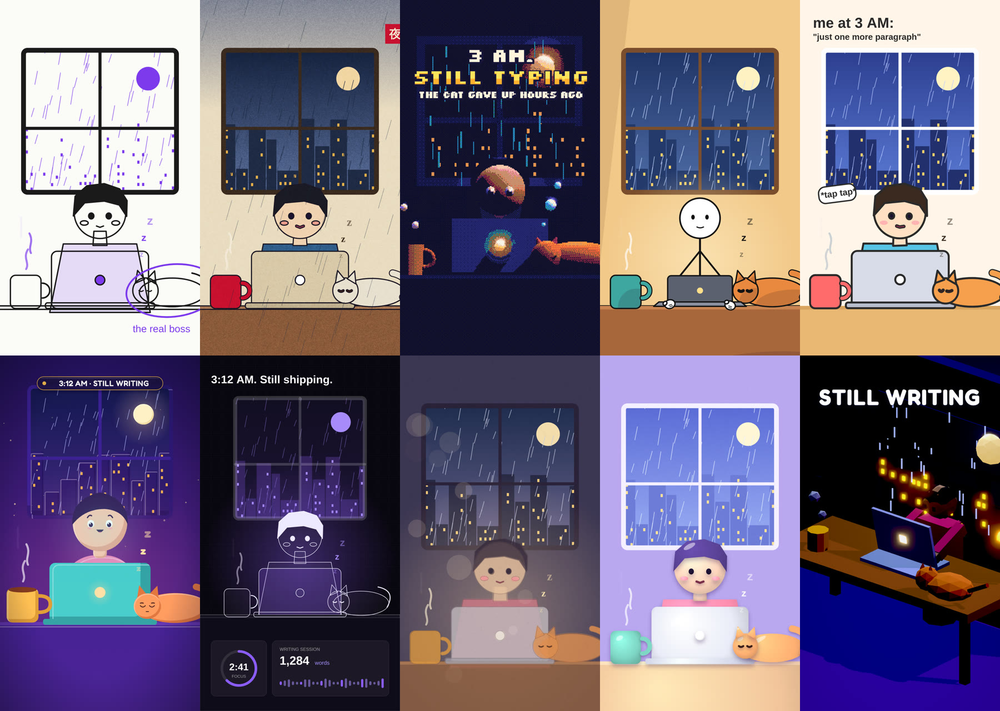

# claude-video-studio — one install for code-driven video in Claude Code

Turn a script or idea into a finished 9:16 or 16:9 MP4 written entirely in code. Every frame is a deterministic pure function of time (`window.renderFrame(f)`), captured headlessly with Playwright + Chromium, scored with real or synthesized sound cues, and checked with `earshot` and `ffprobe`.



## One-command install

Run this once in your terminal to install all 7 skills, the shared Three.js + SVG + Canvas 2D engine kit, fonts, MotionKit, and 17 slash commands into `~/.claude/`:

```bash
git clone https://github.com/ArtimindStudio/claude-video-studio.git ~/.claude/claude-video-studio && sh ~/.claude/claude-video-studio/install.sh
```

On Windows PowerShell:

```powershell
git clone https://github.com/ArtimindStudio/claude-video-studio.git "$HOME\.claude\claude-video-studio"; powershell -ExecutionPolicy Bypass -File "$HOME\.claude\claude-video-studio\install.ps1"
```

To install into a single project workspace (`.claude/` and `.agent/` for Antigravity) instead of your home folder:

```bash
sh ~/.claude/claude-video-studio/install.sh --project .
```

## Included slash commands

Once installed, type any of these commands directly in Claude Code:

| Command | Style & Engine | Visual grammar |
|:---|:---|:---|
| `/video-studio <topic>` | Orchestrator (any style) | Full 9-step pipeline: treatment, timeline, 3 style-frame previews, motion build, SFX from cues, earshot QA, MP4 |
| `/lowpoly-video <topic>` | Three.js orthographic GPU (`kit/engines/lowpoly`) | Faceted low-poly 3D dioramas, key/fill/rim light, GTAO, bloom, rising titles, spring chips |
| `/pixel-video <topic>` | Three.js + 8-bit shader (`kit/engines/pixel`) | Nearest-neighbour pixel grid, 4x4 Bayer ordered dither, palette snap, bitmap captions, chiptune synth |
| `/flat-video <topic>` | Pure SVG stage (`kit/engines/flat`) | Two-tone flat shapes, radial glows, riggable characters, multi-plane parallax camera |
| `/whiteboard-video <topic>` | Canvas 2D / SVG (`kit/scene_v2`) | Black marker linework on warm off-white, one `#7C3AED` accent annotation, stroke-order draw-on |
| `/ukiyoe-video <topic>` | Canvas 2D (`kit/scene_v2`) | Indigo bokashi sky, carved ink outlines, figure stepped on threes (10 fps), smooth camera, paper grain |
| `/stickman-video <topic>` | Canvas 2D (`kit/scene_v2`) | White circle head, dot eyes, black stick limbs, cartoon gloves inside a cel-shaded 2D world |
| `/doodle-video <topic>` | Canvas 2D (`kit/scene_v2`) | 8 fps boiling ink outlines, flat bright fills, sticker callouts, storytime captions |
| `/keynote-video <topic>` | Canvas 2D / Remotion (`kit/scene_v2`) | Dark `#09070F` hairline grid, `#8B5CF6` accent, glass metric cards, live telemetry |
| `/watercolor-video <topic>` | Canvas 2D (`kit/scene_v2`) | Soft translucent washes, warm lamp screen glow, drifting bokeh, multiply paper texture |
| `/clay-video <topic>` | Canvas 2D (`kit/scene_v2`) | Rounded pastel forms, radial key-light shading, specular highlights, soft contact shadows |
| `/chalkboard-video <topic>` | Canvas 2D / SVG (`cards/chalkboard.md`) | Layered chalk strokes on `#1B2620` slate, hatching, yellow `#FACC15` callouts, eraser wipes |
| `/dankoe-video <topic>` | SVG / Canvas (`cards/minimal-line-art.md`) | White vector paths and node constellations on `#0A0A0C`, progressive stroke draw-on |
| `/glowsketch-video <topic>` | Canvas 2D (`cards/glow-sketch.md`) | Luminous dotted contours on near-black, slow path tracing, restrained pulses |
| `/comicart-video <topic>` | Canvas 2D (`cards/comic-art.md`) | Bold black ink, Ben-Day halftone dots, dynamic panels, impact holds |
| `/editorial-short <topic>` | HTML / Remotion (`kit/motion`) | Warm paper `#F2EFEC`, electric violet `#7C3AED`, Playfair Display italic, blur-swaps, spoken captions |
| `/sound-check <film.mp4>` | Earshot + Real-Sound (`scripts/sound_check.sh`) | Places SFX from `cues.json` and writes `qa/sound/sheet.png`, `timeline.json`, `critique.json`, `measure.json` |

## Included micro-skills (`skills/`)

- **`video-studio`**: Core director skill with 10 style cards (`references/cards/*.md`), `STYLE_CHOOSER.md`, `style-library.md`, `doctor.sh`, `render_html.mjs`, `reading_time.py`, `sfx_from_cues.py`, and `sound_check.sh`.
- **`lowpoly-video`**: Three.js orthographic diorama engine (`engine.js`, `post.js`, `render_gpu.mjs`, `mix.sh`, `qa.sh`, `loop_check.sh`, `references/loop.md`).
- **`pixel-video`**: Three.js 8-bit pixel shader engine (`engine.js`, `pixelpost.js`, `chiptune.py`, `mix.sh`).
- **`flat-video`**: Pure SVG flat-vector engine (`engine.js`, `scenes.js`) with two-tone shading, character rigs, and multi-plane camera.
- **`animation-studio`**: 10 style modules (`pixelart`, `chalkboard`, `glowsketch`, `ps2`, `comicart`, `flatvector`, `dankoe`, `cgimotion`, `legostyle`, `zackdfilms`) with quality rubrics and input contracts.
- **`real-sound`**: Full multi-stem audio supervision pipeline (`analyze.py`, `arrange.py`, `audit.py`, `mix.py`, `qa.py`, `master.py`, `credits.py`, `mux.mjs`).
- **`earshot`**: Local audio listening and SFX forge workflow (pair with [Leonxlnx/earshot](https://github.com/Leonxlnx/earshot)).

## System requirements

- **Node.js 20+** and **Playwright** (`npm i -D playwright && npx playwright install chromium` in your working project)
- **FFmpeg 7+** (`ffmpeg` and `ffprobe` on `PATH`)
- **Python 3.11+**
- **Optional:** [`earshot`](https://github.com/Leonxlnx/earshot) for audio listening QA and the procedural SFX bank (`sh ~/.claude/skills/video-studio/scripts/doctor.sh` prints the exact one-time setup command).

## Companion guide

Full handbook, treatment templates, and style breakdowns: **[Make High-Quality Video with Claude](https://aiartimind.com/claude-video-guide/)**.

## License

MIT — see [LICENSE](LICENSE) and [CREDITS.md](CREDITS.md). Made by [Artimind Studio](https://aiartimind.com).
